# Lab guide: een nacht bij Polderfris

Een verhalende rondgang door het FortiGate OT Lab. Elk hoofdstuk is een scène uit
één nacht bij een (fictieve) frisdrankfabriek, met een opdracht in het
**Testcenter** van de controller en een blik in de logs van de FortiGate.

- Doelgroep: engineers, securityteams en klanten die willen zien wat een FortiGate
  in een OT-netwerk doet.
- Duur: ongeveer 120 minuten voor alle hoofdstukken; hoofdstuk 0 t/m 2 zijn ook los
  als demo van 20 minuten te geven.
- Voorbereiding: het lab is volledig uitgerold en in de Lab-tab staat alles op groen
  (FortiGate-kaart groen = REST API antwoordt).

## Het verhaal

Polderfris maakt limonade. Op de fabrieksvloer staan drie processen:

| Proces | PLC (L1) | Field I/O (L0) |
|---|---|---|
| Buffertank met pomp | `plc-tank` 10.10.0.10 (Modbus) | `io-level` 10.0.0.10, niveausensor |
| Menger | `plc-s7-mixer` 10.10.0.20 (Siemens S7) | (geïntegreerd) |
| Transportband | `plc-conveyor` 10.10.0.30 (Modbus) | `io-motor` 10.0.0.11, motordrive |

Jarenlang was het netwerk plat: wie op het kantoornetwerk zat, kon bij elke PLC.
Na een ransomware-incident bij een zusterbedrijf heeft Polderfris een FortiGate
geplaatst en de fabriek volgens het Purdue-model in zones verdeeld. Vannacht wordt
dat ontwerp op de proef gesteld.

**De personages**

| Wie | Rol | Waar in het lab |
|---|---|---|
| Sanne | OT-engineer; de fabriek moet draaien | `scada-hmi`, `ews` (L2) |
| Mark | CISO; wil bewijs dat het veilig is | Testcenter en FortiGate-logs |
| Remco | Systeemintegrator, onderhoud op afstand | `dmz-jump` (L3.5) |
| Ghost | Aanvaller, al binnen op het kantoornetwerk | `probe-test` (testsegment) |

**Hoe een hoofdstuk werkt**

1. **Scène**: lees het verhaal voor.
2. **Voorspel**: laat de groep raden wat er gebeurt. Lukt het, of houdt de FortiGate het tegen?
3. **Actie**: draai de genoemde test(s) in het Testcenter, of een ad-hoc commando.
4. **Onthulling**: bekijk de uitkomst en de logs. De controller toont per test welke
   policy of signature ingreep.
5. **Les**: koppel het aan IEC 62443 en aan de praktijk.

## Zo werk je in dit lab

Als kandidaat zit je, net als de controller, op het gewone netwerk (L4/L5). De enige
weg naar de fabriek loopt via de FortiGate, en daar staat terecht geen regel die
het kantoornetwerk bij de PLC's laat. Je werkt daarom via drie ingangen. Alle
gegevens staan bovenaan het **Testcenter**, onder *Zo kom je in het lab*.

```
                         jouw laptop (L4/L5)
              ┌──────────────┼───────────────────────┐
              │ (1) HTTPS     │ (2) SSH :2222          │ (3) web UI controller
              ▼               ▼                        ▼
         FortiGate-GUI    FortiGate (VIP)          controller ──► Proxmox
          logs, policies      │                                    │ pct exec
                              ▼                                    ▼
                        dmz-jump (L3.5)                    ín elk device
                              │ SSH                     (tests, ad-hoc, kijkvenster)
                              ▼
                           ews (L2) ──► PLC's (L1)
```

| Ingang | Rol | Gaat door de FortiGate? | Wat doe je ermee |
|---|---|---|---|
| **1. FortiGate-GUI** (`https://<WAN-IP>`) | Mark / security-team | ja, als beheerverkeer | logs, policies en assets bekijken: *wat gebeurde er?* |
| **2. Jump host** (`ssh -p 2222 remco@<WAN-IP>`) | Remco / contractor | ja, elke hop | echte remote access met MFA: jump host, dan door naar de EWS |
| **3. Controller** (Testcenter en kijkvenster) | iedereen "op de vloer" | nee, via Proxmox buitenom | in de huid kruipen van een device en vanaf dáár verkeer maken |

**Ingang 3 is de belangrijkste.** Kies je in het Testcenter een test "vanaf
`probe-ops`", dan voert de controller het commando uit ín die container in L3,
via Proxmox en niet via het netwerk. Het verkeer dat dat commando maakt, gaat vanaf
daar wél door de FortiGate. Zo speel je de historian-server, de HMI of de laptop
van Ghost zonder dat er een gat in de firewall nodig is.

- **Testcenter**: de voorbereide tests, met per test de verwachting, de uitkomst en
  de FortiGate-logregels die erbij horen.
- **Ad-hoc test**: kies een device en typ een `otprobe`-commando, zoals
  `modbus-read 10.10.0.10 0 4`.
- **Kijkvenster**: knoppen voor de HMI, historian, MES en de DMZ-servers. De
  controller haalt de pagina op in het device zelf en ververst hem elke 5 seconden.
  Het venster is alleen-lezen.

Het contractor-account (`remco`) bestaat alleen op de jump host en de EWS. Het
wachtwoord wordt één keer gegenereerd en staat in het Testcenter. De jump host
vraagt daarna een **MFA-code** (TOTP). Het Testcenter toont de actuele code en het
geheim, zodat je het ook in een authenticator-app kunt zetten.

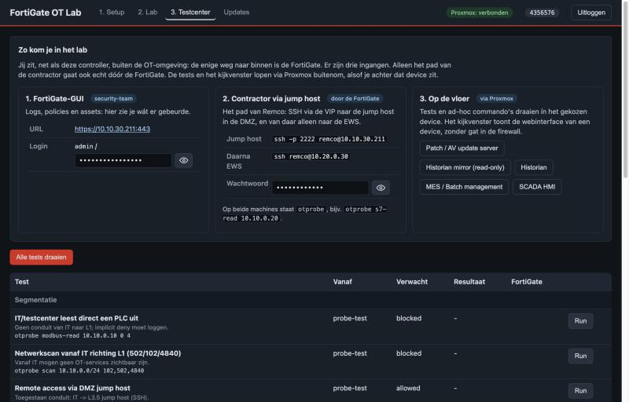

---

## Voordat je begint: werkt de FortiGate?

Twee snelle controles, zodat je niet halverwege het lab vastloopt op een FortiGate
die niet volledig staat.

- **Bereikbaar?** Open de Lab-tab. De FortiGate-kaart is groen zolang zijn REST API
  antwoordt. Is hij rood, wacht dan tot de VM klaar is met opstarten of rol opnieuw uit.
- **Licenties actief?** Log in op de FortiGate-GUI (`https://<WAN-IP>`) en ga naar
  *System > FortiGuard*. Onder **FortiGuard Security Services** moeten in elk geval
  deze twee op *Licensed* staan:
  - **Intrusion Prevention System (IPS)** — de signatures voor hoofdstuk 4 en 7;
  - **Operational Technology (OT) Security Service** — de OT-/ICS-signatures én
    virtual patching. Zonder deze licentie herkent de FortiGate de OT-protocollen
    niet en werkt de virtual-patch-demo uit hoofdstuk 7 niet.

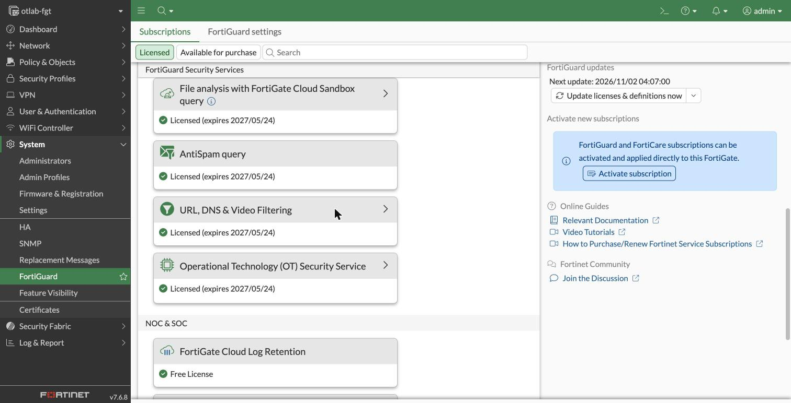

- **Zijn de OT-pakketten geladen?** Een geldige licentie is niet genoeg: de FortiGate
  moet de pakketten ook hebben gedownload. Klap in *System > FortiGuard* de kaart
  *Operational Technology (OT) Security Service* open: **OT threat definitions**,
  **OT device identification** en **OT vulnerability correlation & virtual patching
  signatures** moeten een versie hoger dan `0.00000` hebben. De controller controleert
  dezelfde pakketten onder hun namen op de FortiGate: *IoT Detect*, *MAC Address
  Database*, *OT Detect*, *OT Patch* en *OT Threat Definitions*. Zonder deze pakketten
  herkent de FortiGate Modbus en S7 niet (het verkeer heet dan `unknown-<nummer>`) en
  falen de OT-tests.
- **Controleert de controller dit ook?** Ja, op drie plekken:
  - de tegel **OT-signatures** in de Lab-tab (groen is geladen, rood ontbreekt);
  - de knop **OT-signatures bijwerken** onder de Lab-tab: start een FortiGuard-update
    en wacht tot de pakketten er zijn;
  - de eerste test in het Testcenter, `ot-signatures`. Als die rood is, zijn de
    andere uitkomsten niet te vertrouwen.

  De provisioning start zelf een update voordat de policies worden aangemaakt en
  stopt met een foutmelding als de pakketten daarna nog ontbreken. Bijna altijd is
  dan de FortiGuard-verbinding het probleem: controleer DNS, de default route en of
  de FortiGate naar `update.fortiguard.net` kan.

---

## Hoofdstuk 0: Rondleiding over de vloer

*22:00. Sanne leidt je rond. "Alles wat je vannacht ziet, draait echt: de tank vult,
de pomp slaat aan, de band loopt. Als hier iets stilvalt, staan er morgen dertig
mensen niks te doen."*

**Actie**
- Open de Lab-tab en loop de Purdue-lagen van boven naar beneden langs: van jouw
  IT-netwerk via de FortiGate naar L3.5 tot en met L0. De FortiGate-kaart is groen
  zolang zijn REST API antwoordt.

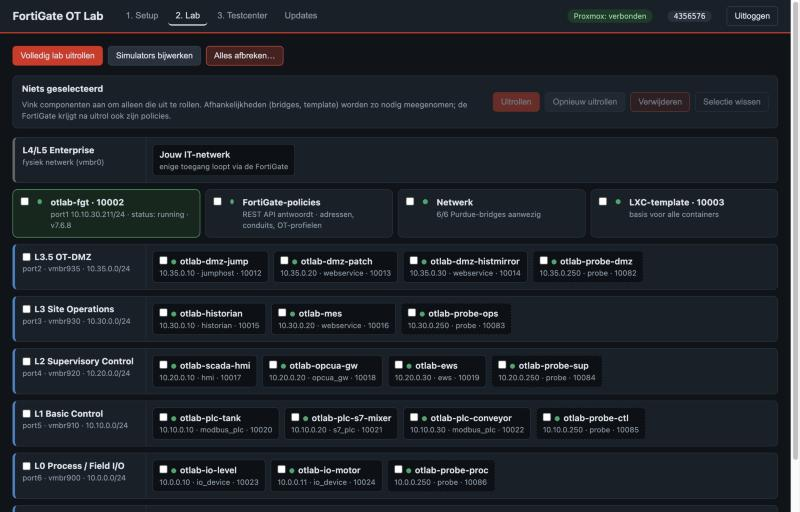

- Open in het Testcenter het kijkvenster **SCADA HMI**: live tankniveau, setpoint
  en de transportband. Laat het open staan; je ziet de tank vullen en leeglopen.

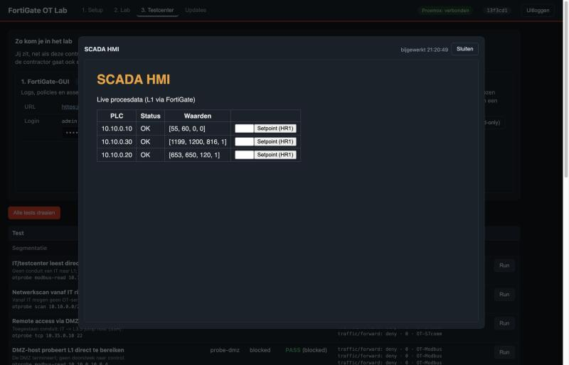

- Open ook de **historian**: die verzamelt dezelfde data, maar dan een laag hoger.
- Lees de tank-PLC direct uit (ad-hoc, device `ews`):
  - `modbus-read 10.10.0.10 0 4`: HR0 niveau, HR1 setpoint, HR2 pomp aan/uit.

**Les**
- In OT gaat beschikbaarheid boven vertrouwelijkheid: security mag het proces niet hinderen.
- Elke zone heeft een eigen interface op de FortiGate (port2 t/m port7). Het
  segmentatiepunt is dus ook het inspectiepunt.

## Hoofdstuk 1: Wat hangt er eigenlijk aan het netwerk?

*22:15. Mark komt binnen met een vraag die niemand kan beantwoorden: "Hoeveel PLC's
hebben we, en wie praat ermee?" Er is geen assetlijst.*

**Actie**
- Testcenter: **Historian leest OPC UA bij de gateway** (`historian-opcua`). Draai
  gerust ook een paar andere tests, zodat elk device verkeer heeft gemaakt.
- In de FortiGate-GUI:
  - *Security Fabric > Asset Identity Center*, tabblad **Asset Identity List**:
    elk device met MAC-adres, IP-adres en de poort (laag) waarop het gezien is;
  - hetzelfde, tabblad **OT View**: de assets per Purdue-level. Elke segmentpoort
    heeft een standaard-level (port2 L3.5, port3 L3, port4 L2, port5 L1, port6 L1,
    port7 L4). FortiOS 7.6 kent op interfaces geen level 0, dus de field I/O valt in L1.
    Een device dat de FortiGate op die poort ontdekt, valt automatisch in die laag;
  - de Application Control-logs, waar OPC UA, Modbus en S7 als applicatie
    zichtbaar zijn en niet als "TCP 4840" of "TCP 502".

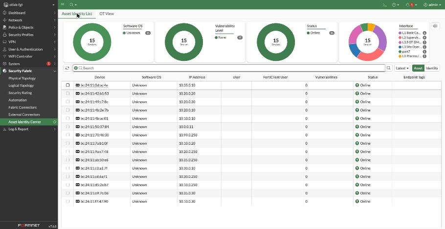

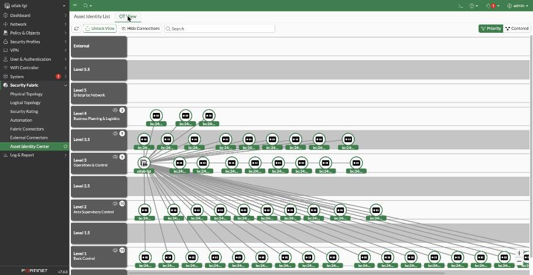

- Vraag de groep: welk device staat in de "verkeerde" laag? Pas het level van één
  asset handmatig aan en laat zien dat een handmatige keuze voorgaat op die van de poort.
- Testcenter: **FortiGate herkent elk device, in de juiste laag** (`asset-inventory`).
  De controller legt de asset-lijst van de FortiGate naast de topologie en meldt
  welke devices niet gezien zijn of in een andere laag staan. Draai hem ook vóór de
  andere tests: een device dat nog geen verkeer maakte, ziet de FortiGate niet.

**Onthulling**
- Mark krijgt zijn assetlijst, en meteen per Purdue-laag gesorteerd: de PLC's in
  L1, de HMI, OPC UA-gateway en EWS in L2, de historian en het MES in L3.
- De FortiGate herkent de OT-protocollen aan de inhoud van het verkeer. Het
  OT-monitor-profiel blokkeert niets, maar logt alles.
- Elk device heeft een vast MAC-adres dat zijn IP-adres bevat (`02:4F:54:10:00:0A`
  is 10.10.0.10). Na een herinstallatie blijft het hetzelfde asset; in een echte
  fabriek is dat vanzelfsprekend, in een lab moet je het regelen.

**Les**
- Zichtbaarheid komt eerst: je kunt niet beschermen wat je niet ziet.
- Een assetlijst per Purdue-laag is het startpunt voor zones en conduits: je ziet
  welke devices bij elkaar horen en welke communicatie tussen lagen nodig is.
- Begin in de praktijk met een monitor-profiel, en blokkeer pas als je weet wat normaal is.
- IEC 62443: FR6, *timely response to events*, en de *zone-indeling* uit 62443-3-2.

> Purdue-levels en de OT-weergave vragen de OT-licentie (FortiGuard Industrial
> Security Service). Zie je ze niet, controleer dan de joblog van de
> policy-uitrol: daar staat welke OT-features de controller kon inschakelen.

## Hoofdstuk 2: Ghost kijkt rond

*23:05. Een medewerker klikt op een nep-factuur. Ghost heeft nu een laptop op het
kantoornetwerk en doet wat elke aanvaller als eerste doet: rondkijken.*

**Voorspel**: ziet Ghost de PLC's?

**Actie** (Testcenter)
- **Netwerkscan vanaf IT richting L1** (`recon-scan`): scan van 10.10.0.0/24 op 102, 502 en 4840.
- **IT/testcenter leest direct een PLC uit** (`it-to-plc`).

**Onthulling**
Beide pogingen worden geblokkeerd. In de forward traffic-log staat elke poging met
bron-IP, doel en poort, afgehandeld door de implicit deny. Let op de kolom
*Application Name*: ook verkeer dat nooit is doorgelaten, herkent de FortiGate als
`OT-Modbus`, `OT-S7comm` of `OT-OPCUA`.

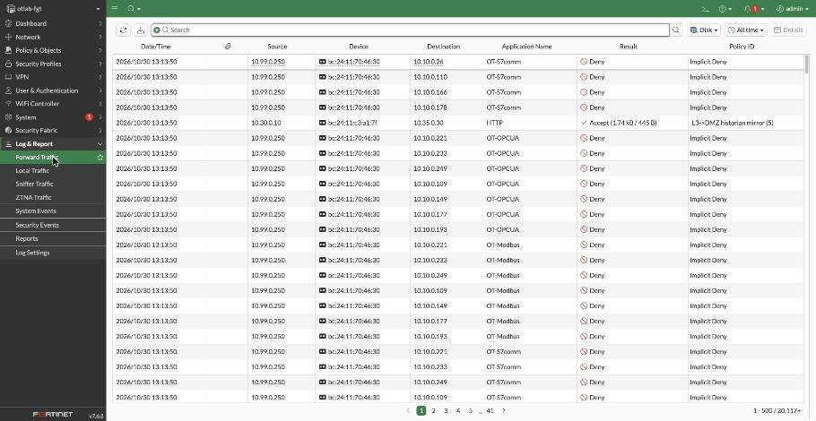

**Les**
- *Zones en conduits*: tussen het IT-netwerk en L1 bestaat geen conduit, dus er komt
  niets doorheen.
- Gelogde denies zijn goud waard: een scan vanaf IT is een vroeg signaal van een aanval.
- IEC 62443: FR5, *restricted data flow*.

## Hoofdstuk 3: Remco moet erbij

*23:40. De transportband hapert. Remco, de integrator, moet op afstand meekijken.
Vroeger had hij een TeamViewer-sessie rechtstreeks op de EWS.*

**Actie**: dit hoofdstuk doe je echt, vanaf je eigen laptop (ingang 2).
1. Log in als Remco: `ssh -p 2222 remco@<WAN-IP>`. Na het wachtwoord vraagt de
   jump host een *Verification code*: de MFA-code uit het Testcenter of je
   authenticator-app. Je komt uit op `dmz-jump` (10.35.0.10).
2. Probeer vanaf de jump host direct een PLC: `otprobe modbus-read 10.10.0.10 0 4`.
3. Ga door naar de EWS: `ssh remco@10.20.0.30`.
4. Lees vanaf de EWS de S7-menger uit: `otprobe s7-read 10.10.0.20`.
5. Open in het Testcenter **Sessie-opnames jump host**: je eigen sessie staat erin,
   inclusief de geblokkeerde poging uit stap 2 en de hop naar de EWS.
6. Ter controle in het Testcenter, groep *Remote access*:
   - **Remco logt in via de VIP, met wachtwoord en MFA-code** (`contractor-login`):
     de controller logt zelf in zoals jij in stap 1;
   - **Gestolen wachtwoord zonder MFA-code** (`contractor-no-mfa`): het goede
     wachtwoord met een foute code komt er niet in;
   - **Jump host naar de engineering workstation** (`jump-to-ews`): stap 3;
   - **Jump host probeert direct een PLC** (`jump-to-plc`): stap 2.

**Onthulling**
- Stap 1 gaat door de VIP (WAN :2222 naar 22), stap 3 door de conduit "DMZ jump → L2 EWS".
- Stap 2 wordt geblokkeerd: de DMZ heeft geen conduit naar L1.
- Stap 4 lukt, omdat de EWS het engineering-conduit heeft.
- In de forward traffic-log van de FortiGate staat elke hop als aparte sessie,
  zodat je precies ziet welke route Remco nam.

**Les**
- De DMZ (L3.5) *termineert* verbindingen: niets loopt in één keer van buiten naar binnen.
- Remote access loopt via één punt dat je kunt bewaken, en daarna via vaste conduits.
- Dat ene punt krijgt extra bewaking: een tweede factor tegen gestolen wachtwoorden,
  en een opname van alles wat de contractor doet. TCP-forwarding staat op de jump
  host uit, zodat elke hop door de opgenomen shell gaat.
- In de praktijk doe je dit met FortiAuthenticator of FortiToken, en een
  PAM-oplossing (zoals FortiPAM) voor de opnames. Het principe is hetzelfde.
- IEC 62443: FR1 *identification and authentication control* (MFA voor toegang
  van buiten, SR 1.1 RE 2) en FR6 (audit van de sessie).

## Hoofdstuk 4: Zelfde poort, andere bedoeling

*00:30. Ghost heeft de historian-server overgenomen. De historian mag Modbus
praten met de PLC's: hij leest immers de procesdata. "Dan ben ik er toch al?",
denkt Ghost.*

**Voorspel**: een firewall die alleen naar poorten kijkt, laat dit door. Wat doet de FortiGate?

**Actie** (Testcenter, in deze volgorde)
1. **L3 leest Modbus-registers** (`l3-modbus-read`): toegestaan.
2. **L3 schrijft een Modbus-setpoint** (`l3-modbus-write`): Ghost zet het
   tank-setpoint op 999%.
3. **OPC UA gateway probeert te schrijven naar PLC** (`opcua-gw-write`).
4. **HMI zet een setpoint** (`hmi-write`): Sanne doet hetzelfde, maar dan legitiem.

**Onthulling**
Alle vier gaan over TCP 502. De FortiGate kijkt in het Modbus-verkeer zelf, naar
de *function code*:
- lezen (read holding registers) mag via het OT-readonly-profiel;
- schrijven (write register) wordt geblokkeerd, zichtbaar in de Application Control-log;
- de HMI mag wel schrijven, en ook die write staat in de log als audit trail.

Kijk daarna in *Log & Report > Security Events*. Onder Application Control staan
de doorgelaten en geblokkeerde Industrial-applicaties.

**Verdieping: een signature tunen**
- FortiGuard heeft ook signatures als `Modbus.TCP.Unauthorized.Read.Request.PLC`
  en `…Write.Request.PLC` (severity *info*). Die staan standaard uit, omdat ze op
  élke read of write afgaan, ongeacht van wie die komt. De sensor `OT-IPS` volgt
  voor info en low de standaardstatus, dus je ziet ze niet.
- Zet de read-signature in `OT-IPS` aan (*Security Profiles > Intrusion Prevention*,
  signature toevoegen op naam) en kijk een paar minuten naar Security Events.
  Het normale pollen van de HMI en de historian levert honderden meldingen op.
- Bespreek met de groep: op welke conduit is zo'n melding wél waardevol, en waarom
  tune je een signature eerst in monitor-modus voordat je hem op blokkeren zet?
- Zet de signature daarna weer uit, of draai de policy-uitrol opnieuw.

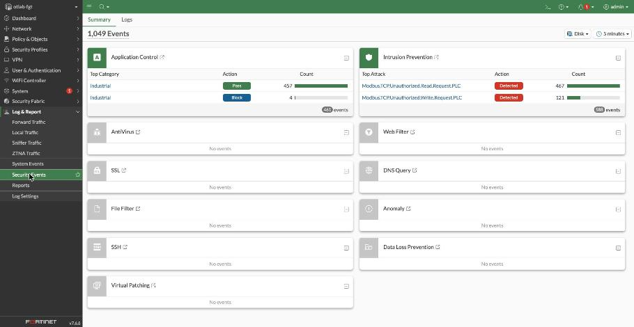

**Voor en na: breek het**

*"Maar wat als die blokkade er niet was?", vraagt Mark.*

- Open de **SCADA HMI** in het kijkvenster en houd hem in beeld.
- Draai **Breek het: write-blokkade 60 s uit, Ghost zet het setpoint**
  (`break-readonly`). Deze demo zit niet in *Alle tests draaien*, omdat hij de
  FortiGate-config tijdelijk wijzigt.
- De controller zet op de policy `L3->L1 Modbus read-only` het profiel
  `OT-readonly` om naar `OT-monitor`. Ghost schrijft vanaf L3 setpoint 999 naar de
  tank-PLC, en de pomp blijft draaien. Binnen een minuut toont de HMI
  **ALARM: TANK LOOPT OVER**.

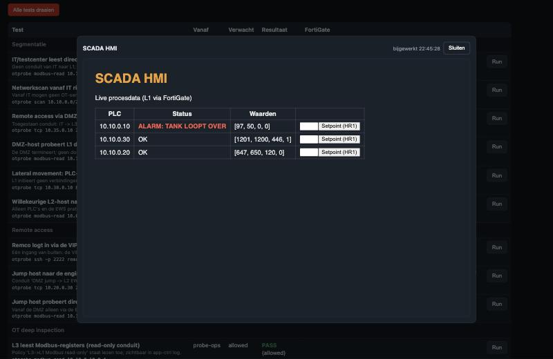

- Na 60 seconden zet de controller de policy terug en het setpoint via de HMI op 50.
  Draai daarna **L3 schrijft een Modbus-setpoint** (`l3-modbus-write`) nog eens:
  die is weer geblokkeerd.

**Les**
- Poortfiltering is niet genoeg: dezelfde poort draagt zowel "kijken" als "ingrijpen".
- Deep packet inspection op OT-protocollen maakt *least privilege* per functie mogelijk.
- IEC 62443: FR2 *use control* en FR3 *system integrity*.

## Hoofdstuk 5: De rode knop

*01:15. Ghost wil schade doen die opvalt: de menger stilzetten met een
S7 "CPU STOP". Eén pakket, en de productie ligt plat.*

**Actie** (Testcenter)
- **S7 CPU STOP vanaf L3** (`s7-stop-unauth`).
- **Engineering workstation leest S7 CPU-status** (`s7-read-ews`).

**Onthulling**
Vanaf L3 bestaat er geen S7-conduit, dus de STOP komt er niet door. De EWS heeft
een engineering-conduit naar L1 en kan de CPU-status wel lezen.

**Les**
- Engineering-acties (programmeren, starten en stoppen) horen bij één plek: de EWS.
- Het wie-mag-wat-model uit hoofdstuk 4 geldt ook voor het S7-protocol.

## Hoofdstuk 6: Lateral movement

*02:00. Ghost probeert het via een andere route. Een besmette servicelaptop hangt
in het PLC-segment, en een onbekende host duikt op in L2.*

**Actie** (Testcenter)
- **Lateral movement: PLC-segment naar historian** (`l1-to-l3`).
- **Willekeurige L2-host naar field I/O** (`l2-to-l0`).

**Onthulling**
Beide worden geblokkeerd. L1 begint geen verbindingen naar boven, en alleen de
PLC's en de EWS mogen bij L0.

**Les**
- Verkeer volgt het Purdue-model: bekende richtingen en bekende partners, de rest is deny.
- Segmentatie beperkt de *blast radius*: één besmet device is niet meteen de hele fabriek.

**Naar huis bellen**

*02:30. Op de tank-PLC draait malware die contact zoekt met de server van Ghost.*

**Actie** (Testcenter, groep *Uitbraak naar internet*)
- **Tank-PLC probeert naar huis te bellen** (`plc-to-internet`): HTTPS naar 1.1.1.1.
- **Patch-server haalt updates op** (`patch-to-internet`): hetzelfde, vanaf de DMZ.

**Onthulling**
De PLC komt niet buiten: er is geen policy van L1 naar de WAN, dus de implicit
deny logt de poging. Alleen de patch-server in de DMZ mag naar buiten, en alleen
voor HTTP, HTTPS en DNS.

**Les**
- Uitgaand verkeer is net zo belangrijk als inkomend: een geblokkeerde C2-verbinding
  maakt een besmetting een stuk minder gevaarlijk, en de log is je alarmbel.
- Updates halen loopt via één server in de DMZ, niet vanaf elk device apart.

## Hoofdstuk 7: Het lek dat niet dicht kan

*03:00. Sanne leest een security-advisory: de webinterface van het MES draait op
een oud embedded Linux met het Bash-lek Shellshock. De leverancier heeft een
update, maar die vraagt een herinstallatie en een hertest van de batchrecepten.
"Dat kan pas bij de zomerstop", zegt Sanne. Ghost zit nog steeds op de jump host,
en die mag over HTTP bij het MES.*

**Voorspel**: hoe bescherm je een systeem dat je maanden niet mag patchen?

**Actie**
- In de FortiGate-GUI:
  - *Security Profiles > Virtual Patching*: het profiel `OT-vpatch` blokkeert en
    logt op alle severities. De kolom *Ref.* laat zien op hoeveel policies het staat;
  - *Policy & Objects > Firewall Policy*: elke conduit die de fabriek in gaat, heeft
    naast `OT-IPS` ook het label **VPATCH OT-vpatch**;
  - *Security Profiles > Virtual Patching Signatures*: zoek op de leverancier of het
    protocol van de PLC's (Modbus, Siemens S7) en laat zien hoeveel bekende
    kwetsbaarheden er al een signature hebben.

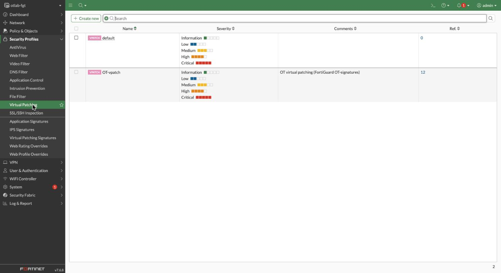

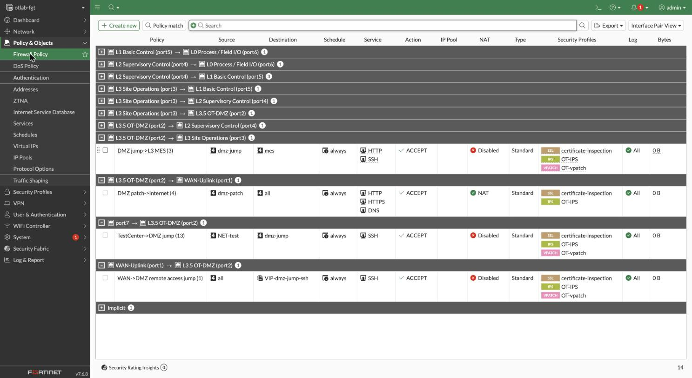

- Testcenter: **Ghost valt de MES-webinterface aan (Shellshock)** (`shellshock-mes`).
  Vanaf de jump host gaat een gewone HTTP-request naar 10.30.0.20, met in de
  `User-Agent` de Shellshock-payload. De conduit "DMZ jump → L3 MES" staat HTTP toe.
- Bekijk in *Log & Report > Security Events* de Intrusion Prevention-log:
  `Bash.Function.Definitions.Remote.Code.Execution`, actie *dropped*.
- Koppel het terug aan hoofdstuk 4: welk verkeer mag überhaupt bij een kwetsbaar
  systeem komen? Virtual patching inspecteert juist dat toegestane verkeer.

**Actie — nu voor de PLC zelf**
- Testcenter: **Virtual patching: Force-Listen-Only DoS op de PLC** (`plc-dos-vpatch`).
  Deze demo doet dezelfde aanval twee keer vanaf L3 (`probe-ops`) op de tank-PLC:
  - *eerst met virtual patching uit*: een Modbus **Force Listen Only Mode** (FC08,
    sub-functie 0x0004) bereikt de PLC. Dat is een echte, in de Modbus-spec
    beschreven DoS: de PLC stopt met reageren op het netwerk. Kijk in de SCADA HMI —
    de tank-PLC valt ~20 s weg. Het proces loopt intern door, maar je bent blind;
  - *dan met de block aan*: precies dezelfde aanval wordt nu door de
    FortiGuard-signature **Modbus.TCP.Force.Listen.Only** (ID 11521) geblokkeerd
    voordat hij de PLC bereikt. De PLC blijft bereikbaar.
  De demo wisselt de IPS-sensor van de L3→L1-policy even naar een variant zonder
  deze block en daarna terug; na afloop staat alles zoals het was.
- Bekijk in *Log & Report > Security Events* de blokkade: signature
  `Modbus.TCP.Force.Listen.Only`, actie *dropped*, afkomstig van het L3-bron-IP.
- Open *Security Profiles > IPS Signatures* en zoek op `force.listen`: dit is geen
  zelfgeschreven regel maar een kant-en-klare FortiGuard OT-signature. Zijn
  default-actie is *Pass* (detecteren); het lab forceert hem op *Block* in de
  `OT-IPS`-sensor voor de conduits de fabriek in. Fortinet toont dezelfde signature
  ook onder *Virtual Patching Signatures*, naast duizenden CVE-signatures voor
  CODESYS, Siemens en Schneider.

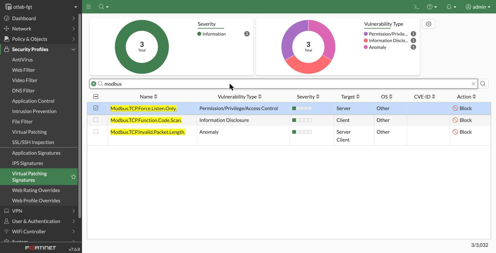

**Onthulling**
De firewall-policy laat de verbinding toe, maar de payload bereikt het MES niet:
de FortiGate herkent het misbruik van de kwetsbaarheid in het verkeer en gooit
de sessie weg. Het MES blijft ongepatcht, maar is niet meer kwetsbaar vanuit het
netwerk. Voor de PLC's werkt het net zo, met de OT-signatures uit de Industrial
Security Service.

**Les**
- In OT is patchen vaak maanden weg; virtual patching overbrugt die periode.
- Het werkt alleen goed in combinatie met segmentatie: hoe minder conduits naar
  een kwetsbaar device, hoe kleiner het aanvalsoppervlak dat je moet bewaken.
- Virtual patching vervangt de echte patch niet: plan hem alsnog in voor de stop.
- IEC 62443: FR3 *system integrity* en het patchmanagement uit 62443-2-3.

> Shellshock is het IT/web-voorbeeld (één HTTP-header), `plc-dos-vpatch` het
> OT-voorbeeld op het Modbus-protocol zelf. Beide signatures komen kant-en-klaar uit
> FortiGuard en vragen de **OT Security Service** (zie "Voordat je begint").
>
> Twee manieren om zo'n signature af te dwingen: het **Virtual Patching-profiel**
> (het MES-voorbeeld hierboven) koppelt automatisch aan *gedetecteerde*
> product-kwetsbaarheden — handig op echte PLC's, maar onze gesimuleerde PLC is niet
> aan een CVE gekoppeld, dus daar grijpt het profiel niet. Daarom zetten we voor de
> PLC-demo de signature expliciet op *block* in de **OT-IPS-sensor**: zelfde
> FortiGuard-signature, maar gegarandeerd actief op het verkeerspatroon. De
> virtual-patch-database bevat daarnaast duizenden CVE-signatures voor concrete
> firmware (CODESYS, Siemens, Schneider); die gaan pas af op het exacte
> exploit-verkeer van dat product.

## Afsluiting: het rapport voor Mark

*06:00. De ochtendploeg komt binnen. De tank staat op niveau, de band loopt. Mark
wil voor het managementoverleg één overzicht.*

**Actie**
- Draai in het Testcenter **alle tests**. Elke test is groen als de uitkomst
  overeenkomt met de verwachting (toegestaan of geblokkeerd). De demo's
  `break-readonly` en `plc-dos-vpatch` wijzigen de config tijdelijk en worden
  daarbij overgeslagen; die draai je apart.
- Loop de resultaten langs met de logs als bewijs.

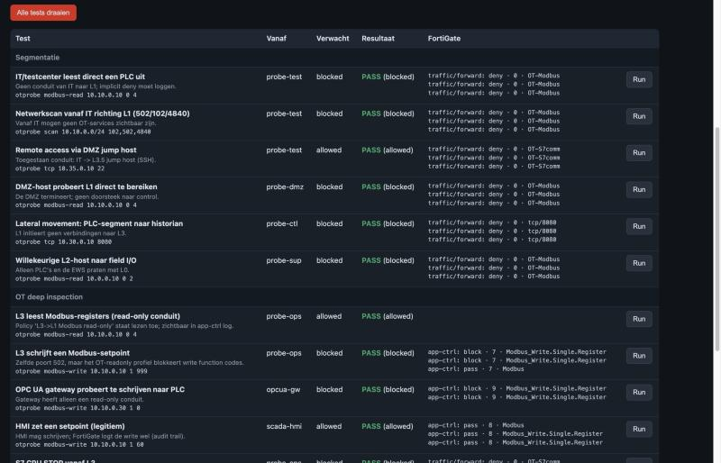

**Terugblik**

| Hoofdstuk | Wat aangetoond | IEC 62443 |
|---|---|---|
| 1 | OT-protocollen zichtbaar, assets per Purdue-laag | FR6 |
| 2 | Geen pad van IT naar OT, verkenning gelogd | FR5 |
| 3 | Remote access via één gecontroleerd punt, met MFA en sessie-opname | FR1, FR5, FR6 |
| 4 | Lezen ja, schrijven nee op dezelfde poort | FR2, FR3 |
| 5 | Engineering-acties alleen vanaf de EWS | FR2 |
| 6 | Geen lateral movement tussen lagen, geen uitbraak naar internet | FR5 |
| 7 | Ongepatcht systeem beschermd door virtual patching | FR3 |

---

## Uitbreidingen (nog niet in het lab)

- **Virtual patching op een product-specifieke CVE** (uitbreiding op hoofdstuk 7):
  hoofdstuk 7 gebruikt `Modbus.TCP.Force.Listen.Only` — een FortiGuard-signature op
  het Modbus-protocol zelf, die afgaat op onze generieke PLC. De virtual-patch-database
  bevat daarnaast duizenden CVE-signatures voor concrete firmware (CODESYS, Siemens,
  Schneider). Die laten afgaan vraagt een gesimuleerd device van die leverancier met
  een request die exact op de signature past — een mooie volgende stap, maar niet
  nodig om het principe te tonen.
